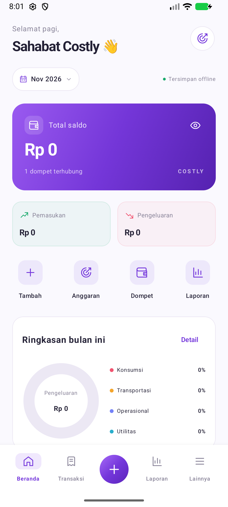

# Costly 💰

<div align="center">

### Modern, Purposeful & Offline-First Personal Finance for Android

[-3DDC84?style=for-the-badge&logo=android&logoColor=white)](https://developer.android.com)
[](https://kotlinlang.org)
[](https://developer.android.com/jetpack/compose)
[](https://m3.material.io)
[](https://developer.android.com)

<br/>



<br/>
<br/>

*Designed for clarity, financial discipline, and total data privacy. Zero tracking, zero telemetry, and zero unencrypted cloud dependencies.*

</div>

---

## ✨ Features at a Glance

- **📊 Comprehensive Financial Dashboard**: Real-time aggregated balance across all accounts, monthly income/expense metrics, interactive Canvas category donut chart, category budget progress bars, and recent transaction history.
- **💳 Multi-Wallet & Accounts**: Unified tracking for Cash, Bank Accounts, and E-Wallets with initial balance calculations and automated balance updates. In-use wallets are protected from accidental deletion.
- **🏷️ Customizable Categories**: Distinct income and expense categories featuring custom vector icons and relational integrity safeguards.
- **🎯 Monthly Budgets & Spending Limits**: Establish per-category spending ceilings with visual progress meters and instant over-budget alerts.
- **🌱 Savings Goals**: Set target amounts and target dates, track incremental savings contributions, and visualize timeline progress.
- **🔁 Recurring Scheduled Transactions**: Automate daily, weekly, or monthly income and expenses. Due entries automatically catch up on application launch and through background WorkManager workers.
- **🤝 Debts & Receivables**: Track borrowed and lent money, payment progress, remaining balances, due dates, and settlement status.
- **📈 Comprehensive Financial Reports**: Analyze financial summaries, category distribution, and cumulative cash flow trends. Export reports directly to **PDF**, **Excel (.xlsx)**, and **CSV** formatted in your active language and currency.
- **🔐 PIN & Biometric Security**: Secure 6-digit PIN hashed using PBKDF2 with unique salts, brute-force rate-limiting timeouts, and biometric fingerprint/face authentication. Automatically locks when the app is backgrounded.
- **📦 Encrypted Backups**: ZIP backups containing the SQLite database and all file attachments encrypted with AES-256-GCM using PBKDF2-HMAC-SHA256 key derivation.
- **⏰ Automated Scheduled Backups**: Background WorkManager jobs run every 1, 6, 12, or 24 hours to a user-selected local folder, retaining up to 30 historical backup versions.
- **☁️ Google Drive Cloud Backup (Hybrid Dual-Backup)**: Directly connect your personal Google Drive account via OAuth 2.0. Backups are stored locally and mirrored to your personal Google Drive automatically. All cloud files remain 100% zero-knowledge encrypted with AES-256-GCM. Includes in-app cloud backup browsing and one-click restore.
- **🌐 Native Android Localization & Multi-Currency**: Built using Android's standard XML string resource architecture with native Android 13+ Per-App Language Preferences (`locales_config.xml`). Seamlessly switch between Indonesian (Bahasa Indonesia) and English, and choose from multiple world currencies (IDR, USD, EUR, GBP, SGD, MYR, JPY, AUD).

---

## 🌐 Localization & Multi-Currency Architecture

Costly adheres to standard Android localization practices for UI strings, coupled with a flexible runtime model for currency formatting.

```
app/src/main/res/
├── values/strings.xml          # Default language (Bahasa Indonesia)
├── values-en/strings.xml       # English translations
├── xml/locales_config.xml      # Android 13+ Per-App Language configuration
```

### Standard XML Resource Strings
All UI strings reside in Android's standard `res/values/strings.xml` and `res/values-en/strings.xml`. In Compose, strings are accessed reactively via `LocalStrings.current` (powered by `AppStrings(context)` delegating to `context.getString(R.string.xxx)`).

### Android 13+ Per-App Language Preferences
With `minSdk 33` and `locales_config.xml`, users can change the language:
1. Directly inside the app via **Settings > Language**.
2. Or via Android System Settings: **Settings > System > Languages > App Languages > Costly**.

### How to Add a New Language

Adding a new language takes zero Kotlin code modifications:

1. In Android Studio, right-click `res/values` → **New** → **Values Resource File**, name it `strings.xml`, and select your target **Locale** (e.g. `Spanish (es)` or `Japanese (ja)`). Alternatively, open the **Translations Editor** in Android Studio to edit translations side-by-side.
2. Add your new language tag to `app/src/main/res/xml/locales_config.xml`:
   ```xml
   <locale-config xmlns:android="http://schemas.android.com/apk/res/android">
       <locale android:name="id" />
       <locale android:name="en" />
       <locale android:name="es" /> <!-- New language -->
   </locale-config>
   ```
3. Android OS and Costly will automatically recognize and load the new language!

### How to Add a New Currency

Currencies are managed via `LocalizationManager.registerCurrency()` in [Localization.kt](app/src/main/java/com/katowproject/costly/Localization.kt):

```kotlin
val btc = AppCurrency(
    code = "BTC",
    symbol = "₿",
    name = "Bitcoin",
    symbolPrefix = true
)
LocalizationManager.registerCurrency(btc)
```

The newly registered currency automatically appears in **Settings > Currency** and dynamically updates all amount displays, summary cards, and PDF/Excel/CSV exports.

---

## ☁️ Google Drive Cloud Backup (Hybrid Sync)

Costly features dual-mode hybrid backups combining local storage with private Google Drive synchronization:

- **Zero-Knowledge Encryption**: Backups are encrypted on-device with AES-256-GCM using PBKDF2 before transmission. Neither Google nor third parties can inspect your records without your master backup password.
- **Per-User Isolation**: Backups are uploaded directly into each user's personal Google Drive using the `https://www.googleapis.com/auth/drive.file` scope. No central server or developer storage is involved.
- **Automated Dual-Sync**: When both local and Drive backups are enabled, background WorkManager jobs create the local archive and mirror it to Google Drive, automatically pruning older files based on your configured retention policy.
- **In-App Cloud Restore**: Browse, inspect timestamps and file sizes, and restore historical backups directly from Google Drive.

---

## 🛠️ Tech Stack & Architecture

- **UI Framework**: Jetpack Compose with Material 3 design system.
- **Language**: Kotlin 2.2.10 (Target SDK 37, Min SDK 33 / Android 13+).
- **Architecture**: MVVM with unidirectional data flow (UDF) and `AndroidViewModel`.
- **Database**: Offline-first SQLite database (`SQLiteOpenHelper`) with transactional queries, foreign key enforcement, and relational consistency.
- **Security**: AES-256-GCM encryption, PBKDF2-HMAC-SHA256 key derivation, Android BiometricPrompt API, and Android Keystore.
- **Background Tasks**: Android WorkManager for scheduled encrypted backups and recurring transaction processing.
- **Reporting & Documents**: Custom low-memory streaming OOXML (.xlsx) builder, Android native `PdfDocument` graphics canvas, and RFC 4180 CSV exporter with formula injection mitigation.

---

## 🚀 Getting Started

### Prerequisites

- Android 13+ emulator or physical device (API level 33+).
- Java Development Kit (JDK) 17+ or Android Studio JBR.
- Android SDK Platform 37.

### Running with VS Code

1. Open the project root directory in VS Code.
2. Open **Run and Debug** (`Ctrl+Shift+D`), select **Costly: Build & Run Android**, and press **F5** (or press `Ctrl+Shift+B` to run the default build task).
3. The build automation script will start the emulator (if not already running), compile the debug APK, install it, and launch Costly.

### Windows Automation Scripts

PowerShell / CMD:
```powershell
# Start the Android emulator
.\scripts\start-emulator.cmd

# Build, install, and run the app
.\scripts\build-and-run.cmd

# Stop the emulator when finished
.\scripts\stop-emulator.cmd
```

Git Bash:
```bash
bash scripts/start-emulator.sh
bash scripts/build-and-run.sh
```

### Manual Gradle Build

Point `JAVA_HOME` to Android Studio's JBR runtime:

```powershell
$env:JAVA_HOME = 'C:\Program Files\Android\Android Studio\jbr'
$env:PATH = "C:\Program Files\Android\Android Studio\jbr\bin;$env:PATH"

# Assemble Debug APK
.\gradlew.bat :app:assembleDebug

# Run Unit Tests
.\gradlew.bat :app:testDebugUnitTest
```

Built APK location: `app/build/outputs/apk/debug/app-debug.apk`.

---

## 🧪 Verification & Testing

Costly includes extensive test suites covering:
- **Finance Store Tests**: Balance calculations, multi-wallet isolation, cross-month arithmetic, category budget enforcement, and transaction CRUD operations.
- **Recurring Transactions**: Idempotency checks and catch-up rules preventing duplicate automated transactions.
- **Encrypted Backup & Restore**: Archive integrity, roundtrip backup/restore with file attachments, password rejection, and recovery tests.
- **Localization & Currencies**: Locale date/month formatting, dynamic currency formatting across multiple world currencies, frequency canonicalization, and language registry.
- **Report Exporters**: Formula cell neutralization in CSV exports, OOXML XML structure validity in Excel exports, and localized document headers.

Run all unit tests:
```powershell
.\gradlew.bat :app:testDebugUnitTest
```
